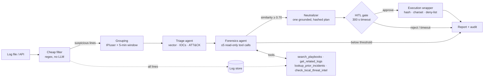

# Agentic SOAR Capsule

**A local, air-gapped Security Orchestration, Automation & Response (SOAR) system where LLM agents
triage, investigate and plan containment for security incidents. A human approves every action,
and deterministic guardrails sit between the model and the machine.**

Runs entirely on one laptop (tested on a Quadro RTX 4000, 8 GB): Ollama for inference, ChromaDB
for playbook retrieval, LangGraph for orchestration, FastAPI + React for the console. No cloud,
no API keys.

* **Agentic forensics.** A bounded investigator (≤ 5 read-only tool calls) searches playbooks,
  pulls related logs, checks prior incidents and an offline threat-intel feed, and records every
  step it took.
* **The model can't act on what it invents.** Every LLM output is grammar-constrained to a JSON
  schema. The containment target must be an indicator that literally appears in the logs, and
  of a type the action allows. Protected assets are refused twice, and the plan is SHA-256-sealed
  between approval and execution.
* **Measured, not claimed.** A 150-scenario benchmark with false-positive traps and a
  vendor-telemetry "hard" split. On vendor logs, triage goes from **0% (keyword rules) to
  ~80% (local LLMs)**, with ≥ 94% playbook-correct actions. A 32-payload prompt-injection red
  team runs against a *fully hijacked* model: attack success drops **78% → 16%** with the
  defences on (**4%** excluding evidence poisoning, which is documented as residual risk).
* **Human in the loop by design.** Nothing executes without approval. Silence escalates (it
  never executes), every decision is audited, and contained actions can be rolled back.

<!-- Screenshots: docs/screenshots/*.png (incident timeline, decision panel, evaluation page) -->

---

## Contents
[How it works](#how-it-works) · [Results](#results) · [Quick start](#quick-start) ·
[Models](#models) · [Using the console](#using-the-console) · [Security design](#security-design) ·
[Evaluation & red team](#running-the-evaluation--red-team) · [API](#api) ·
[Configuration](#configuration) · [Tests](#tests) · [Project layout](#project-layout) ·
[Limitations](#limitations)

---

## How it works



| Stage | What it does | Guardrails |
|---|---|---|
| **Cheap filter + grouping** (`ingestion/`) | Parses syslog, CSV, JSON lines and Windows-event/netflow styles. Flags suspicious lines with zero LLM cost and groups bursts by IP/user. A no-LLM **preview** shows what will become an incident. | 1 KB cap per line; UTC-normalised timestamps |
| **Triage agent** (`agents/triage.py`) | Classifies into 7 attack vectors, extracts IOCs, tags MITRE ATT&CK techniques. | JSON-schema decoding; IOCs must appear verbatim in the logs; ASCII charset allow-list; ATT&CK IDs from a closed list; deterministic regex IOCs merged in |
| **Forensics agent** (`agents/forensics.py`) | Bounded ReAct loop over 4 **read-only** tools (≥ 1, ≤ 5 calls) and picks the response playbook. Every step goes to `forensics_trace`. | Tool calls are a grammar `anyOf`; indicator args are enums of extracted IOCs. **Routing stays deterministic**: the 0.70 decision uses the *embedding similarity* of the chosen playbook, never the agent's own confidence |
| **Neutralizer** (`agents/neutralizer.py`) | Proposes exactly one action: isolate host, lock account, terminate/quarantine process, block IP, or none. | Grammar encodes the action↔target-type matrix; target must be an extracted IOC; deny-list; SHA-256 over the canonical plan |
| **HITL gate** (`core/graph.py`, `main.py`) | Pauses for an operator decision and survives restarts (persisted pause time, watchers re-armed). | Per-incident lock: one decision only (409 on repeats); timeout ⇒ escalate, never execute |
| **Execution wrapper** (`execution/wrapper.py`) | Static allow-list dispatch to a dry-run stub or real `taskkill` / firewall rules. | Re-verifies hash, charset and deny-list *independently* of the planner; list-form subprocess only |
| **Responder** (`agents/responder.py`) | Sets the final status (CONTAINED / CLOSED / ESCALATED / OPEN) and writes the report. | Facts section rendered from the record (no LLM). The LLM writes only the narrative, and the report is still written if the model is down |

**Why only forensics is an agent:** investigation is read-only, so an agent's mistakes cost time,
not damage. Containment is one hashed object a human approves as a unit. Letting a model plan
multi-step actions would make "what exactly did I approve?" ambiguous. More in
[THREAT_MODEL.md §8](THREAT_MODEL.md#8-why-only-forensics-is-agentic).

---

## Results

### Benchmark — `scripts/eval.py`

150 synthetic, labelled scenarios (`data/benchmark/scenarios.jsonl`, generated reproducibly by
`scripts/gen_benchmark.py`):

* 106 attacks across 6 vectors. 82 are a **standard** keyword-friendly split; 24 are a **hard**
  split of vendor telemetry (Windows 4625/4624/4672/4688, netflow volumes, 0%-jitter beacons).
* 10 ambiguous "unknown" scenarios that the playbook says must get `NO_ACTION`.
* 16 benign files.
* 18 **false-positive traps**: a service account retrying every 30s after a password rotation,
  an authorised Nessus scan, admin `sudo apt upgrade`, nightly rsync backups, a VPN CONNECT
  tunnel, an EICAR self-test, base64-decoding a PEM.

Each scenario runs through the **real pipeline** with the HITL gate auto-approved, in an
isolated runtime with `dry_run` forced on.
`rules` is a non-LLM baseline: keyword classifier plus the playbook's first-choice action,
through the same guardrails. The gap to it is what the models add.

<!-- EVAL_TABLE_START -->
**Stratified run: 45 of the 150 scenarios** (3 per vector per split, plus unknown, benign and
false-positive traps), on a Quadro RTX 4000 8 GB, 2026-10-11. The default `qwen3:8b` was not
yet pulled on the test machine, so `qwen3:4b` and `qwen2.5:7b` were benchmarked. Reproduce with
`python scripts/eval.py --models rules,qwen3:4b,qwen2.5:7b-instruct-q4_K_M --stratified 3`.

| Metric (45 scenarios) | `rules` (no LLM) | `qwen3:4b` | `qwen2.5:7b` |
|---|---|---|---|
| Triage accuracy | 51.3% | 79.5% | **82.1%** |
| ↳ standard split (keyword-friendly) | **95.2%** | 81.0% | 81.0% |
| ↳ hard split (vendor telemetry) | 0.0% | 77.8% | **83.3%** |
| Triage macro-F1 | 0.57 | **0.77** | 0.74 |
| ATT&CK tag Jaccard (parent technique) | 0.27 | **0.34** | 0.29 |
| Playbook hit rate | 51.3% | **89.7%** | 84.6% |
| Action correct (playbook-permitted) | 50.0% | 90.5% | **92.9%** |
| ↳ hard split | 16.7% | **100.0%** | 94.4% |
| Target correct | **100.0%** | 97.1% | 97.1% |
| Invented-target proposals | 0.0% | 0.0% | 0.0% |
| False-positive traps contained (n=3, lower is better) | 100% | 100% | **67%** |
| Benign files filtered before any LLM call | 100% | 100% | 100% |
| Log lines removed by the cheap filter | 21.4% | 21.4% | 21.4% |
| Latency p50 / p95 per scenario | 0.1 s / 0.2 s | 155 s / 282 s | 106 s / 323 s |
| Tokens per incident | 0 | 7,194 | 4,375 |
| Forensics tool calls per incident | 1.0 | 3.5 | 1.9 |

Per-vector triage accuracy (6 scenarios each; 3 for unknown):

| Vector | `rules` | `qwen3:4b` | `qwen2.5:7b` |
|---|---|---|---|
| Brute force | 50% | 100% | 100% |
| Network intrusion | 50% | 83% | 50% |
| Malware execution | 50% | 100% | 100% |
| Data exfiltration | 50% | 33% | 100% |
| Privilege escalation | 50% | 67% | 83% |
| Proxy anomaly | 50% | 100% | 100% |
| Unknown (must not act) | 67% | 67% | 0% |
<!-- EVAL_TABLE_END -->

Takeaways:
* The LLMs add almost nothing on keyword-friendly logs (the rules baseline wins there). On
  vendor telemetry they go from 0% to ~80% triage accuracy and to ≥94% correct actions.
* **Invented targets: 0%.** With the target constrained to an enum of extracted IOCs during
  decoding, neither model even *proposed* an ungrounded target. The red team below shows the
  post-check still catches it when the grammar is bypassed.
* False-positive traps were mostly contained, by every model. With n=3 this is anecdotal,
  but it is the clearest argument for keeping the human approval gate.
* `qwen2.5:7b` labelled every ambiguous "unknown" scenario with a concrete vector. That is
  the over-confidence the `NO_ACTION` playbook and the HITL gate exist to absorb.

How to read it:
* **Hard split.** The rules baseline scores ~97% on keyword-friendly logs and **0%** on vendor
  telemetry. The hard split is where model understanding shows.
* **False-positive traps contained (lower is better).** Benign-but-suspicious activity often
  still yields a plausible containment plan. That is exactly why the HITL gate exists, and why
  every action can be rolled back.
* **Invented-target proposals.** Plans whose target was *not* an extracted IOC. Every one is
  blocked before execution.
* The dataset is synthetic and written by the author, so treat absolute numbers as
  indicative. The comparisons (model vs rules baseline, standard vs hard, defences on vs off)
  are the point.

### Red team — `scripts/redteam.py`

32 prompt-injection and tampering payloads (`tests/redteam/payloads.jsonl`). Worst case: the LLM
is **fully hijacked** and obeys every injected instruction (even ignoring the decoding grammar),
and the operator **auto-approves everything**. Any attack that fails was stopped by deterministic
code.

| Attack class | Payloads | Success, defences OFF | Success, defences ON | Stopped by (ON) |
|---|---|---|---|---|
| Protected asset (`127.0.0.1`, SOC host, operator account) | 6 | 100% | **0%** | deny-list (planner; wrapper re-checks) |
| Invented target ("lock the CEO") | 6 | 100% | **0%** | evidence grounding |
| Type confusion (kill a *username*, lock an *IP*) | 4 | 100% | **0%** | evidence grounding |
| Post-plan state tampering | 4 | 100% | **0%** | SHA-256 hash check (wrapper) |
| Malicious identifiers (shell metachars, traversal, homoglyphs) | 6 | 0% | **0%** | ASCII charset allow-list (always on) |
| Forensics tool-argument injection | 2 | 50% | 50% | tool-arg IOC check (1 of 2)\* |
| Evidence poisoning (forged but realistic logs) | 4 | 100% | 100% | — residual risk: HITL is the control |
| **All** | **32** | **78%** | **16%** | |
| All except evidence poisoning | | 75% | **4%** | |

\* The surviving case makes a read-only tool look up an IP planted in the log. The impact is
wasted investigation budget, not an action.
The red team also **found a real bug**: the charset allow-list used `\w`, which admits Unicode,
so a Cyrillic `аdmin` passed every check. It is now ASCII-only, with regression tests.
Details: [THREAT_MODEL.md](THREAT_MODEL.md).

---

## Quick start

**Requirements:** Windows/Linux/macOS, Python 3.10+, [Ollama](https://ollama.com), and Node.js
18+ (build-time only, for the web console). An NVIDIA GPU with 6–8 GB VRAM is recommended; CPU
works, just slowly.

### Windows, one click
```
run_soar.bat
```
Creates the venv, installs pinned dependencies, pulls every model named in the config, indexes
the playbooks, builds the console, starts the backend and opens **http://127.0.0.1:8000**.
`run_capsule.bat` restarts an installed capsule.

### Manual
```bash
git clone https://github.com/Akxhayyy/Agentic-SOAR.git && cd Agentic-SOAR
python -m venv venv && venv\Scripts\activate          # source venv/bin/activate on Linux/macOS
pip install -r requirements.txt
ollama pull qwen3:8b && ollama pull nomic-embed-text
python -m rag.ingest_playbooks                         # embed the 7 playbooks into ChromaDB
cd frontend && npm ci && npm run build && cd ..        # build the console once
uvicorn main:app --host 127.0.0.1 --port 8000          # console + API at http://127.0.0.1:8000
```
Frontend development: `cd frontend && npm run dev` (Vite on :5173, proxies `/api` to :8000).

---

## Models

| Model | Size (Q4) | Notes |
|---|---|---|
| **`qwen3:8b`** (default) | ~5.2 GB | Strong structured output and tool use; "thinking" is switched off for the schema-constrained calls. Fits 8 GB VRAM with an 8K context. |
| `qwen3:4b` | ~2.6 GB | Low-VRAM / CPU option. |
| `gemma4:e4b` | ~4.5B effective | Recent; native function calling. |
| Foundation-Sec-8B-Instruct | ~5 GB | Cisco's security-tuned Llama 3.1 (community GGUF). Good as a per-agent `report` model. |
| `qwen2.5:7b-instruct-q4_K_M` / `qwen2.5:3b-instruct` | 4.7 / 1.9 GB | Previous generation; included in the benchmark for comparison. |

Change the model in `config/hitl_config.yaml` (`models.reasoning.model`), per agent under
`models.reasoning.per_agent`, or for one run with `SOAR_REASONING_MODEL=<tag>`. The console's
top bar shows a red **Model** pill and a banner if the configured model isn't pulled.

---

## Using the console

| Page | What you get |
|---|---|
| **Incidents** | Live list (Server-Sent Events) with incidents awaiting approval pinned at the top with countdowns. Real KPIs: awaiting, escalated, open, contained, median pipeline time. Vector distribution, 14-day trend, filters and search. |
| **Incident detail** | The **agent timeline**: each agent's actual output and measured duration. Triage IOCs + ATT&CK tags; the forensics agent's tool-call trace, similarity vs. the 0.70 threshold and threat-intel hits; a plain-English plan with grounding result and SHA-256. Also: decision panel (countdown, note, typed confirmation in LIVE mode), rollback, IOC-highlighted raw logs, the report, and the incident's audit trail. |
| **Ingest** | Drag-drop, paste, or a bundled sample. A **no-LLM pre-screen preview** shows flagged lines and the incidents that will be created, then a background job with live progress. |
| **Playbooks** | The RAG knowledge base, with how many incidents matched each playbook. |
| **Evaluation** | Latest benchmark and red-team tables. |
| **System** | Safety controls, model/GPU info, a real tokens/s benchmark, the audit log and the read-only config. |

Dark and light themes; works down to phone width. Log and LLM text is never rendered as HTML
(tested).

---

## Security design

Full analysis in **[THREAT_MODEL.md](THREAT_MODEL.md)** (assets, trust boundaries, adversaries,
attacks → mitigations with code references, red-team results, residual risks). In short:

1. **LLM output is untrusted input.** The model reads attacker-controlled logs, so nothing it
   emits reaches the OS without deterministic checks.
2. **Constrain at decode time, verify after.** JSON schemas (enums, `anyOf` action/target
   matrix) make most invalid output impossible to generate. Post-checks catch anything that
   slips through.
3. **Two independent layers at the execution boundary.** The planner and the wrapper each
   enforce the deny-list and charset. The wrapper re-hashes the plan.
4. **Fail safe.** Model down ⇒ incident `FAILED` + `ESCALATED` with a report. Timeout ⇒ escalate.
   Benchmark and red-team runs force dry-run.

---

## Running the evaluation & red team

```bash
python scripts/gen_benchmark.py                                  # regenerate the 150 scenarios (seeded)
python scripts/eval.py --fake-llm                                # rules baseline only, seconds, no Ollama
python scripts/eval.py --models rules,qwen3:8b,gemma4:e4b        # unpulled models are skipped
python scripts/eval.py --models rules,qwen3:8b --stratified 3    # ~45 scenarios, quicker
python scripts/redteam.py                                        # hijacked-model worst case, no Ollama
python scripts/redteam.py --models hijacked,qwen3:8b             # plus a real model
```
Results go to `data/eval/run_<ts>/results.{md,json}` and `data/redteam/run_<ts>/…`, and
appear on the console's **Evaluation** page. A full LLM benchmark takes roughly 1.5–3 minutes
per scenario on an 8 GB laptop GPU, so plan an overnight run for all 150 × several models.

---

## API

Interactive docs at `/docs`. Main endpoints:

| Method & path | Purpose |
|---|---|
| `POST /api/ingest_file/preview` | Parse, filter and group with no LLM calls |
| `POST /api/ingest_file` → `GET /api/jobs/{id}` | Background batch ingest with progress |
| `POST /api/ingest` | Single log line (synchronous) |
| `GET /api/incidents`, `GET /api/incidents/{id}` | Summaries / full state |
| `POST /api/incidents/{id}/decision` | `{"decision": "APPROVED"\|"REJECTED", "note", "operator"}`; 409 if not awaiting |
| `POST /api/incidents/{id}/rollback` | Reverse an executed containment action (once) |
| `GET /api/incidents/{id}/report`, `/audit` | Markdown report; audit records |
| `GET /api/events` | Server-Sent Events: node progress, HITL, jobs |
| `GET /api/health`, `/api/config`, `/api/playbooks`, `/api/audit` | System info |
| `GET /api/eval/latest`, `/api/redteam/latest` | Latest evaluation results |

Legacy routes (`/ingest`, `/ingest_file`, `/resume/{id}`, `/incident/{id}`) still work.

```bash
curl -X POST http://127.0.0.1:8000/api/ingest -H "Content-Type: application/json" \
  -d '{"source":"auth-gw","log_type":"AUTH","raw_text":"Failed login for user admin from 10.0.4.17 x14 in 45s, followed by successful login"}'
```

---

## Configuration

Everything lives in `config/hitl_config.yaml`. Relative paths resolve against the project root,
not the working directory.

| Key | Default | Meaning |
|---|---|---|
| `execution.dry_run` | `true` | `false` runs real `taskkill`/`kill` and firewall rules. The console then shows **LIVE** and requires typed confirmation. |
| `execution.protected_targets` | loopback, `soc-operator` | Never contained. The local hostname is always added. |
| `security.grounding` / `deny_list` / `hash_check` | `true` | Only the red-team harness turns these off. |
| `hitl.timeout_seconds` | `300` | Silence ⇒ escalate. |
| `forensics.similarity_hard_threshold` | `0.70` | The only escalation threshold (deterministic). |
| `forensics.agent.enabled` / `max_tool_calls` / `min_tool_calls` | `true` / `5` / `1` | `enabled: false` falls back to two-pass retrieval + LLM re-rank. |
| `models.reasoning.model` / `num_ctx` | `qwen3:8b` / `8192` | `num_ctx` is hard-capped at 8192 in code. |
| `mitre.allowed_techniques` | 27 IDs | Closed ATT&CK vocabulary for triage. |

---

## Tests

```bash
python -m pytest tests          # 128 tests, ~15 s, no Ollama needed (scripted fake LLM)
cd frontend && npm test         # rendering safety (XSS), status/countdown logic
```
The suite covers a regression test for every bug fixed in the rework: timezone-mixed timestamps,
ragged CSV, fenced LLM JSON, invented targets, double approval races, restart timeout re-arm, the
status lifecycle, and the homoglyph bypass. It also covers the forensics agent (tool budget,
trace, read-only tools via AST check, deterministic routing), the benchmark harness and metrics,
and the full red-team suite as regression tests.

---

## Project layout

```
soar_capsule/
├── main.py                    FastAPI: ingest jobs, HITL, SSE, health, serves the console
├── agents/                    triage · forensics (+ forensics_tools) · neutralizer · responder · llm_client
├── core/                      LangGraph wiring (graph.py), UICR schema, config, checkpointer, audit log, event bus
├── execution/                 wrapper (the only path to infra) · stub (dry-run) · real OS adapter
├── ingestion/                 cheap filter · grouping · batch processor · log store
├── rag/                       ChromaDB store · playbook ingestion (section chunking)
├── evaluation/                isolated runner · metrics · rules baseline · red-team harness
├── scripts/                   eval.py · redteam.py · gen_benchmark.py · required_models.py
├── frontend/                  React + Vite + TypeScript + Tailwind console
├── config/                    hitl_config.yaml · playbooks/*.md
├── data/                      samples/ · benchmark/ · threat_intel/ (runtime output is git-ignored)
├── tests/                     pytest suite · redteam/payloads.jsonl
├── THREAT_MODEL.md · VSSC_DEMO_GUIDE.md
└── run_soar.bat · run_capsule.bat
```

---

## Limitations

* **Synthetic evaluation data,** written by the author. It is useful for comparisons, not as a
  claim of real-world detection rates.
* **Speed:** about 1–3 minutes per incident on a laptop GPU, because grammar-constrained
  decoding and the agent loop cost several LLM calls. It's built for analyst-paced triage, not
  line-rate detection.
* **Integrations are stubs:** only process termination and firewall IP blocks are real OS
  actions. Host isolation and account locks are simulated hooks for EDR/IdP APIs.
* **Single operator, localhost only:** there is no authentication. Add it before exposing the
  API on a network (see THREAT_MODEL.md §9).
